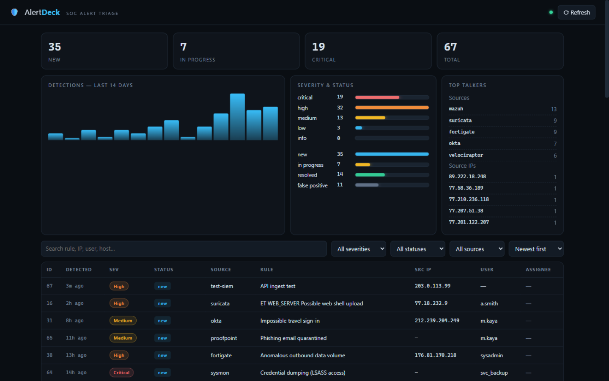
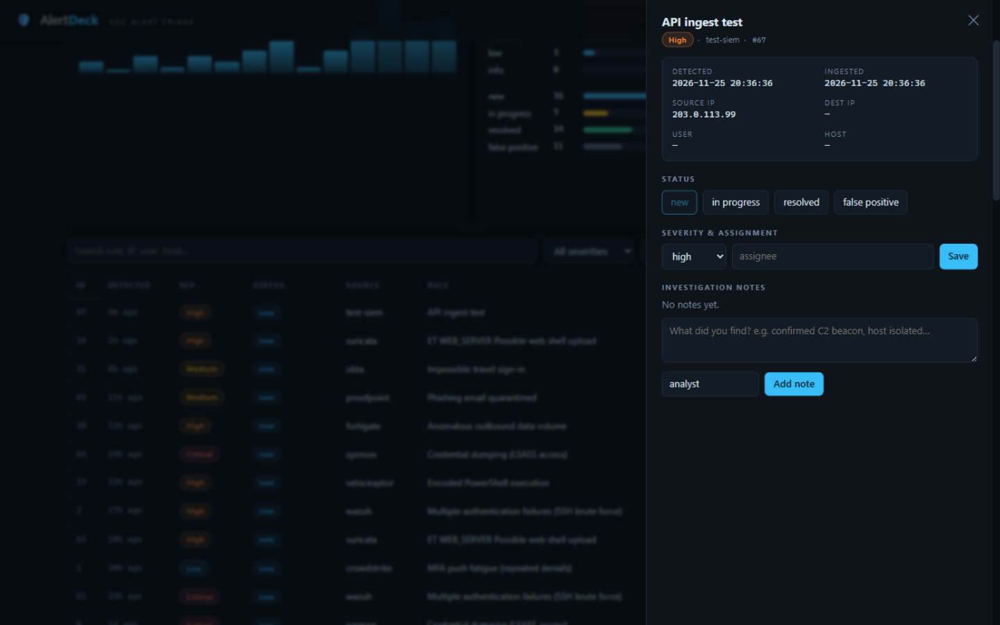

# 🛡️ AlertDeck

**A lightweight, local-first alert triage workbench for SOC analysts.**

[](https://github.com/mustafaak0/alertdeck/actions/workflows/ci.yml)
[](https://www.python.org/)
[](LICENSE)

AlertDeck collects alerts from any source (SIEM webhooks, CSV/JSON exports, manual
entries), stores them in a single SQLite file, and gives you a fast CLI **and** a
dark-themed web dashboard to triage them: filter, sort, assign, change status and
keep an investigation note trail — without shipping your data anywhere.



## ✨ Features

- **Web dashboard** — live stats (new / in-progress / critical / total), a 14-day
  detection timeline, severity & status distribution, top talkers, filterable
  alert table and a triage drawer with one-click status changes, re-assignment,
  severity tuning and an investigation note timeline. Auto-refreshes every 20s.
- **CLI** — the full triage workflow from the terminal (`list`, `show`, `update`,
  `note`, `import`, `stats`, `add`, `demo`), with Rich tables or `--json` output
  for scripting.
- **Flexible ingestion** — `POST /api/alerts` accepts single alerts or batches and
  maps common SIEM field names (`title`, `ip`, `user`, `timestamp`, `sensor`, …)
  automatically. File import supports `.json`, `.jsonl` and `.csv`.
- **Local-first** — one SQLite database (default `~/.alertdeck/alertdeck.db`),
  no external services, no telemetry. Point `ALERTDECK_DB` anywhere you like.
- **Optional write token** — set `ALERTDECK_TOKEN` to require a shared secret on
  all mutating endpoints.
- **Triage lifecycle** — statuses: `new → in_progress → resolved / false_positive`;
  severities: `critical / high / medium / low / info`.



## 🚀 Quickstart

```bash
git clone https://github.com/mustafaak0/alertdeck.git
cd alertdeck
python -m venv .venv && source .venv/bin/activate   # Windows: .venv\Scripts\activate
pip install -e .

alertdeck demo          # seed ~40 realistic sample alerts
alertdeck serve         # start the dashboard → http://127.0.0.1:8000
```

## 🖥️ CLI

```
alertdeck demo [--count N] [--seed S]     Seed sample alerts
alertdeck list [-s SEV] [--status S] [-q QUERY] [--json]
alertdeck show ID                         Alert detail + note history
alertdeck update ID --status in_progress --assignee ayla [-m "note"]
alertdeck note ID -m "contained" [--author ayla]
alertdeck add --source manual --rule "..." -s high --src-ip 1.2.3.4
alertdeck import alerts.json|alerts.jsonl|alerts.csv
alertdeck stats                           Severity/status distribution, top talkers
alertdeck serve [--host 0.0.0.0] [--port 8000]
alertdeck db-path                         Where is my database?
```

## 🔌 REST API

Interactive docs at [`/docs`](http://127.0.0.1:8000/docs) (Swagger UI).

| Method   | Path                        | Description                                  |
| -------- | --------------------------- | -------------------------------------------- |
| `GET`    | `/api/alerts`               | List / filter alerts (`q`, `severity`, `status`, `source`, `assignee`, `sort`, `limit`, `offset`) |
| `POST`   | `/api/alerts`               | Ingest one alert or a batch                  |
| `GET`    | `/api/alerts/{id}`          | Alert detail incl. notes                     |
| `PATCH`  | `/api/alerts/{id}`          | Update `status` / `severity` / `assignee` / `description` |
| `POST`   | `/api/alerts/{id}/notes`    | Append an investigation note                 |
| `GET`    | `/api/stats`                | Counts by severity/status, 14-day timeline, top sources & IPs |
| `GET`    | `/api/meta`                 | Enum values + known sources                  |

Ingest example (works from any SIEM webhook, script or `curl`):

```bash
curl -X POST http://127.0.0.1:8000/api/alerts \
  -H "Content-Type: application/json" \
  -d '{
    "sensor": "wazuh",
    "title": "SSH brute force",
    "severity": "high",
    "ip": "203.0.113.7",
    "user": "root",
    "timestamp": "2026-11-25T09:30:00Z",
    "raw": {"failed_logins": 31}
  }'
```

Field aliases accepted on ingest: `title`/`name`/`rule`/`event_type`/`signature` →
`rule_name`, `sensor`/`product` → `source`, `ip`/`attacker_ip`/`client_ip` → `src_ip`,
`user`/`account` → `username`, `hostname`/`device` → `host`,
`timestamp`/`time` → `detected_at`, `message` → `description`.

## ⚙️ Configuration

| Variable          | Default                        | Purpose                                    |
| ----------------- | ------------------------------ | ------------------------------------------ |
| `ALERTDECK_DB`    | `~/.alertdeck/alertdeck.db`    | SQLite database location                   |
| `ALERTDECK_TOKEN` | *(unset)*                      | If set, required for POST/PATCH endpoints  |

## 📦 Data model

```
alerts(id, created_at, detected_at, source, rule_name, severity, status,
       assignee, description, src_ip, dst_ip, username, host, raw)
notes(id, alert_id, created_at, author, text)
```

See [`samples/sample_alerts.json`](samples/sample_alerts.json) for a ready-to-import
example file.

## 🧪 Development

```bash
pip install -e ".[dev]"
pytest -q
```

CI runs the suite on Python 3.10–3.12
([workflow](.github/workflows/ci.yml)).

## 🗺️ Roadmap

- [ ] Email / Slack / Discord notifications for new critical alerts
- [ ] Multi-user authentication with basic roles
- [ ] Sigma rule import for auto-tagging ingested alerts
- [ ] Enrichment lookups (GeoIP, VT, MISP) from the triage drawer
- [ ] Alert export (CSV / STIX) and case packaging

## 🤝 Contributing

Issues and PRs are welcome — keep changes small, add tests for new behavior,
and run `pytest -q` before submitting.

## 📄 License

[MIT](LICENSE)
